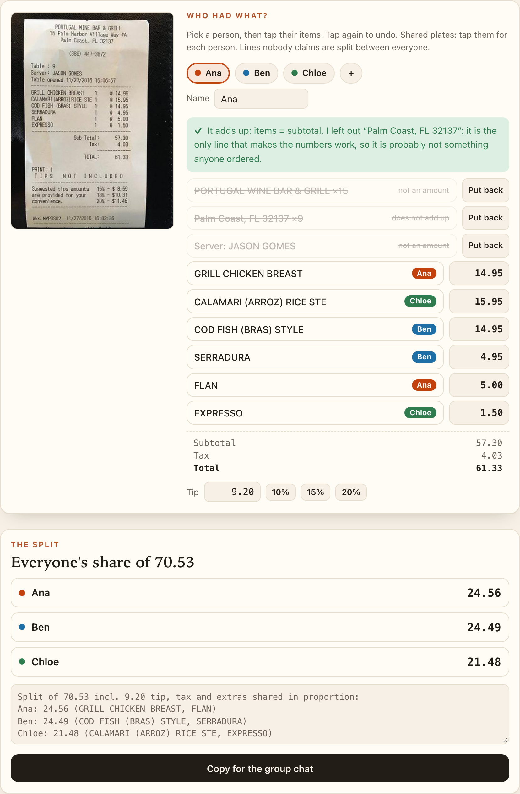
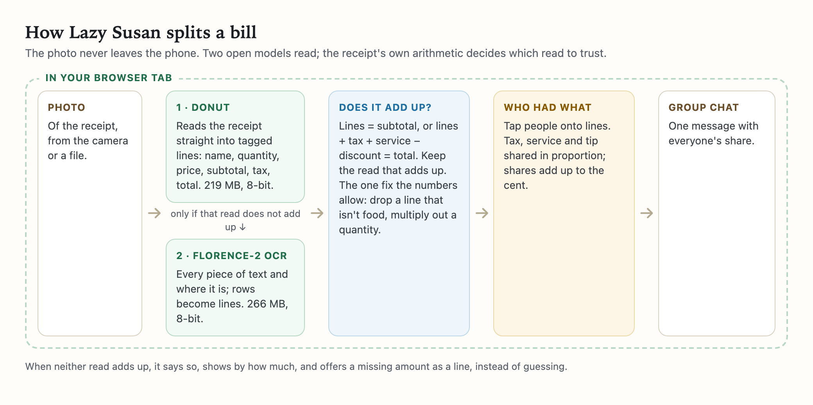

# SplitSnap 🦥

**Receipt Bill Splitter.** Formerly called Lazy Susan.

Photograph the receipt, tap who had what, paste the split in the group chat. The person who paid should not also have to do the maths.

**Donut**, an open-weight document model trained on receipts, reads every line of the photo in your browser. Then the receipt checks the model: the lines have to add up to the subtotal, or with tax, service and discounts, to the total. When they do not, a second open model, **Florence-2**, reads the photo again, and the read that adds up wins. You tap people onto lines, tax, service and tip are shared in proportion, and everyone's share comes out exact to the cent.

**Live:** https://vanshajpoonia.github.io/lazy-susan/



## A receipt is a checksum

A model reading a photo will sometimes misread a digit or mistake the restaurant's name for something you ordered. You cannot ask everyone at the table to proofread it. But a receipt carries its own check: the prices have to add up to the printed subtotal or total. A misread digit almost never cancels out, so when the lines add up, they are very probably all right; when they do not, the app says so, says by how much, and points you at the photo instead of guessing.

The arithmetic can also fix things. When exactly one line makes the numbers work if it is left out (the restaurant's name with the table number as its price), it is left out and the app tells you. When a line shows a price for one and a quantity of three, it is multiplied out if that is what makes the sums work. When a single amount is missing, the app offers it as a line with one tap.

## How it works



- **Donut** ([NAVER Clova](https://github.com/clovaai/donut), MIT) is OCR-free: an image encoder and a text decoder that writes the receipt out as tags (`<s_nm>Pad Thai</s_nm><s_price>10.95</s_price>…`). This is the version fine-tuned on CORD, 800 Indonesian receipts, quantised to 8 bits, run with transformers.js. `src/donut.js` turns the tags into lines.
- **Florence-2** ([Microsoft](https://huggingface.co/microsoft/Florence-2-base-ft), MIT) is the second look. Its OCR returns every piece of text with its position; `src/rows.js` groups the pieces into rows (a name on the left, an amount on the right) and reads the labelled rows at the bottom (subtotal, tax, total, and payment lines to ignore). It only runs, and is only downloaded, when Donut's read does not add up.
- **Two readers, one check.** The two make different mistakes: Donut skips lines and mistakes the shop's name for food on receipts unlike its training data; the OCR reads every line but misreads a digit now and then. Neither knows when it is wrong. The receipt does, so `pick()` in `src/check.js` keeps whichever read adds up (and, if neither does, the one that found more lines).
- **Amounts** (`src/money.js`) come in every format: `13.99`, `$13.99`, `4,75`, `60.000` (sixty thousand rupiah), `1.450,00`. Two digits after the last separator is a decimal part, three is a thousands group, and anything with a time, a date or a word in it is not an amount.
- **The check** (`src/check.js`) tries every way the printed numbers could fit together: lines = subtotal, or lines plus any combination of tax, service, other charges and discount = total. A repair is only taken when exactly one option makes the numbers fit.
- **The split** (`src/split.js`): each line divided between the people who had it (nobody tapped means everyone), everything that is not a line (tax, service, tip, discounts) shared in proportion, then rounded with the largest-remainder method so the shares add up to exactly what the table pays.

## Measured

Every number here comes from `npm test`, which runs the same model on two public datasets:

- **WildReceipt** (Apache-2.0): 1,740 receipts photographed in the wild, mostly from the US, annotated box by box. Donut never saw any of them. The checks were written and tuned on **150 of its training receipts**; the **472 test receipts** were only used to test.
- **CORD** (CC BY 4.0): the 100 test receipts of the dataset Donut was fine-tuned on. This is the in-distribution check.

A receipt's lines count as right when the set of prices matches the annotators' exactly.

**WildReceipt test: 472 receipts, mostly American, neither the checks nor Donut ever saw them** (436 have every line price annotated and readable):

| | Lines shown that are right | Real lines found | Receipts with every line right | Green “adds up” shown | …and every line right | Total to pay right |
|---|---|---|---|---|---|---|
| Donut, as read | 51% | 51% | 3% | | | 53% |
| Donut + the check | 77% | 50% | 21% | 83 receipts | 93% | 57% |
| **Donut + Florence-2 + the check (shipped)** | **75%** | **65%** | **33%** | **131 receipts** | **93%** | **60%** |

**CORD test: 100 Indonesian receipts, the kind Donut was trained on** (99 scoreable):

| | Lines shown that are right | Real lines found | Receipts with every line right | Green “adds up” shown | …and every line right | Total to pay right |
|---|---|---|---|---|---|---|
| Donut, as read | 93% | 92% | 86% | | | 96% |
| Donut + the check | 99% | 93% | 89% | 82 receipts | 100% | 97% |
| **Donut + Florence-2 + the check (shipped)** | 94% | 93% | 88% | 83 receipts | 100% | 94% |

What the tables say:

- **On receipts like the ones it learned from, Donut is excellent**, and the check makes it trustworthy: 82 of 99 CORD receipts add up as read, and all 82 are right line for line.
- **On American receipts, Donut alone reads half the lines.** It skips lines and reads the restaurant, the address or the table number as food. Only 3% of receipts come out completely right as read.
- **The check is what makes it usable.** Dropping lines that are not amounts or are bigger than the bill, and the one repair the arithmetic allows, takes the lines shown from 51% to 77% right. When it shows a green “adds up”, every line is right 93% of the time.
- **The second reader is what makes it lazy.** Florence-2 reads the receipts Donut cannot vouch for, and the arithmetic picks between them: completely right receipts go from 21% to 33%, green ticks from 83 to 131, with the same 93% behind them. Each model is right on receipts the other gets wrong.
- **It costs a little on CORD.** When neither read adds up, the app keeps the one with more lines, and on Indonesian receipts that is sometimes Florence-2's weaker read (94% of shown lines right instead of 99%). The rule was chosen on the WildReceipt tuning receipts, before the test.
- **When it says it does not add up, believe it.** Only 8% of those WildReceipt receipts are completely right, so the warning means: check the photo.
- **Lazy payoff.** A WildReceipt receipt has 5 lines on average, and typing just their prices is 24 keystrokes before a single name. On a third of them SplitSnap needs none; on the green ones it is right 93% of the time; on the rest it shows what is off by how much, next to the photo.

The tuning receipts (`SET=wild-tune npm test`, 137 scoreable): Donut alone 22% completely right and 32 green ticks (84% right); with Florence-2, 34% and 48 green ticks (83% right). The bar the test has to pass (green ticks at least 80% right, more lines found than Donut alone, shown lines more accurate than Donut as read) was set from these before the test receipts were read.

Two rules were added after the test receipts had been read by Donut alone, both from a demo receipt read in the browser: an extra charge as big as the subtotal is the subtotal read twice, and a total the lines do not support is flagged on screen. On WildReceipt, the first changed Donut-alone's figures from 86 green ticks (80 right) and 55% of totals right to 83 green ticks (77 right) and 57%; on CORD it changed nothing.

## In the browser

The tables come from Node, where the whole test re-runs from a cache in seconds. The page runs the same code and the same model files, but not the same arithmetic underneath: the browser decodes and resizes the photo itself and runs the models on ONNX Runtime's WebAssembly build, and Donut's word-by-word decoding amplifies tiny differences. `node scripts/browser.mjs wild 50` runs the page's own steps in Chrome on the first 50 WildReceipt test receipts:

| First 50 WildReceipt test receipts (44 scoreable) | Every line right | Green "adds up" | …and every line right |
|---|---|---|---|
| Node (what the tables above measure) | 36% | 16 receipts | 15 (94%) |
| Chrome, the live page | 23% | 12 receipts | 10 (83%) |

Not one of the 50 reads was word for word the same as Node's. The page is somewhat worse than the headline numbers on this sample, and the green tick held up less well (two wrong out of twelve). It is a small sample, but the gap is real, and I would rather show it than hide it. Shrinking the photo in the browser with high-quality smoothing first (to rule out a poor canvas resize) made no difference.

## Limits

- Donut was trained on 800 Indonesian receipts. On American receipts it skips lines and reads the shop's name as an item now and then; the OCR reader makes digit mistakes. The check catches both, but it cannot fix a receipt neither model can read.
- Handwritten tips and totals are not read. Add the tip in the app.
- A long receipt photographed at an angle, crumpled or in low light is read worse. Flat, straight, filling the frame is best.
- It needs a printed subtotal or total to check against. Without one it still reads the lines, but it cannot vouch for them.

## Run it

```bash
npm start      # static server on :8000, no build step
npm install    # only for the tests
npm test       # unit checks, then the evaluation (downloads both datasets, about 420 MB)
SET=wild-tune npm test               # the 150 receipts the checks were tuned on
node scripts/browser.mjs wild 100    # read 100 receipts in Chrome, then READS=browser SET=wild npm test
```

The first run reads every test receipt with Donut, and with Florence-2 where Donut's read does not add up (about two hours on an M4 the first time); what they read is cached in `tests/.cache`.

## Files

```
src/reader.js     Donut (shared by the browser and the tests)
src/donut.js      Donut's tags -> lines, subtotal, tax, total
src/ocr.js        Florence-2's OCR (shared by the browser and the tests)
src/rows.js       OCR pieces -> rows -> the same lines, subtotal, tax, total
src/money.js      amounts in every format
src/check.js      does it add up, the repairs the arithmetic allows, and which read to keep
src/split.js      who owes what, exact to the cent
src/model.js      both readers in the browser (WASM)
src/app.js        UI
scripts/data.mjs  the datasets, and the cache of what Donut read
scripts/read.mjs  fills those caches (READER=ocr for Florence-2)
scripts/browser.mjs  reads receipts in Chrome with the page's own code
tests/unit.mjs    fast checks, no model
tests/eval.mjs    the evaluation
```

## Credits

Models: [Donut](https://github.com/clovaai/donut) by NAVER Clova (MIT), [fine-tuned on CORD](https://huggingface.co/naver-clova-ix/donut-base-finetuned-cord-v2), [ONNX build](https://huggingface.co/Xenova/donut-base-finetuned-cord-v2); [Florence-2-base-ft](https://huggingface.co/microsoft/Florence-2-base-ft) by Microsoft (MIT), [ONNX build](https://huggingface.co/onnx-community/Florence-2-base-ft). `toJSON` is a port of `DonutProcessor.token2json` from Hugging Face transformers (Apache-2.0). Runtime: transformers.js and ONNX Runtime Web. Data: [WildReceipt](https://arxiv.org/abs/2103.14470) (Apache-2.0, via MMOCR) and [CORD](https://github.com/clovaai/cord) (CC BY 4.0); the sample receipts in `data/samples` come from them.

Code: MIT licence.
